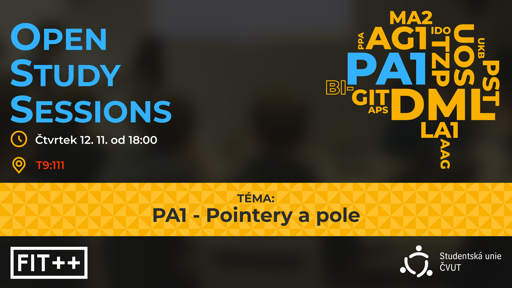

*Záznam akce je dostupný na [YouTube](https://youtu.be/_3dTFobktP8).*
{: style="text-align: center;"}

Chceš si utvrdit jak fungují pointery, či zjistit jak hezky používat structy? Máš mnoho dotazů na ProgTesty a nevíš kde se ptát?

Tak doraž tento čtvrtek na OpenStudySessions, kde se ti pokusíme co nejlépe poradit se vším co tě trápí (v PA1).

{: style="display: block; margin: 0 auto; max-width: 400px;" }
*Původní plakát akce*
{: style="text-align: center;"}